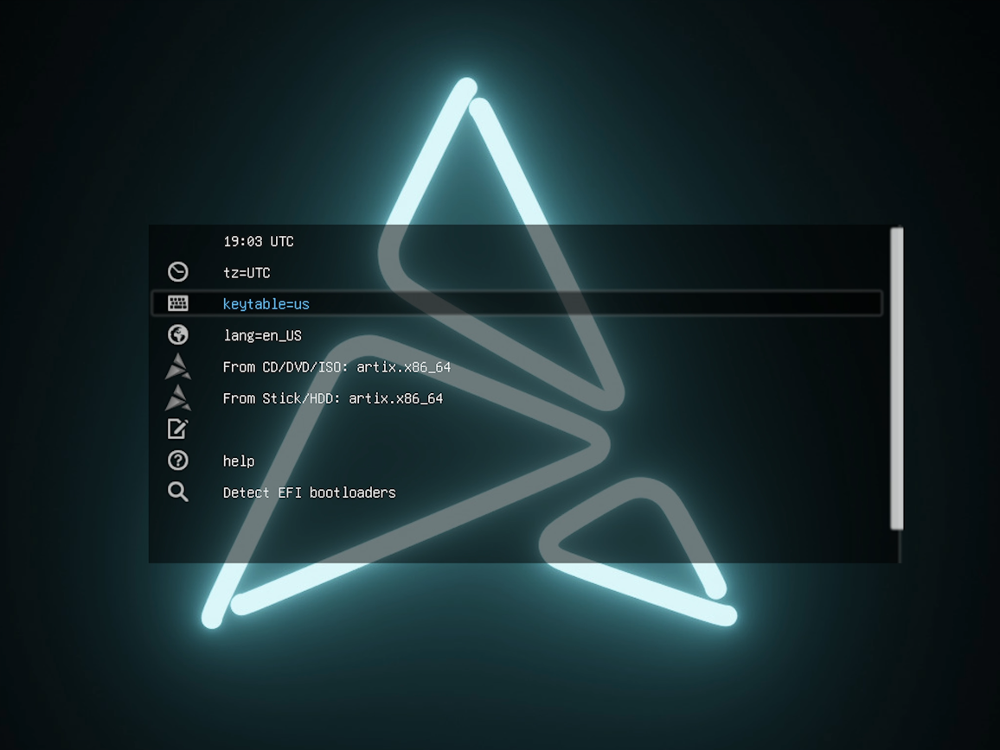
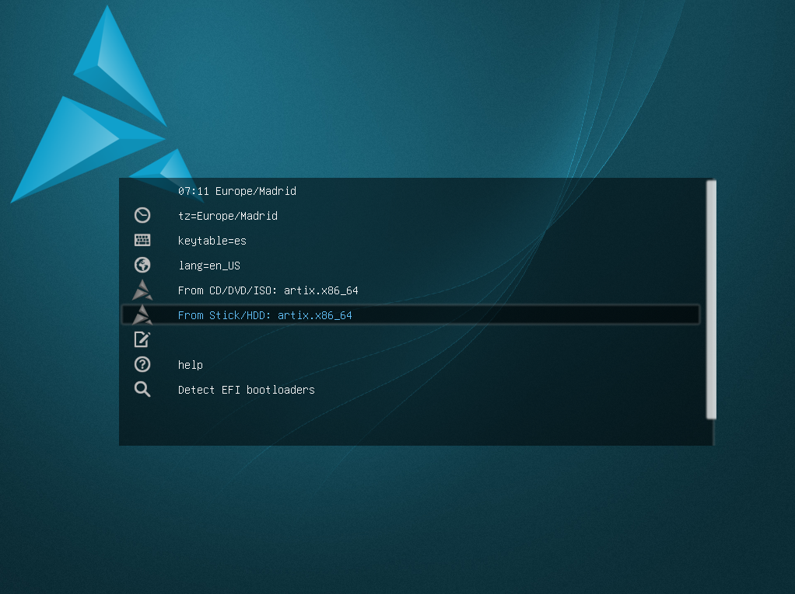
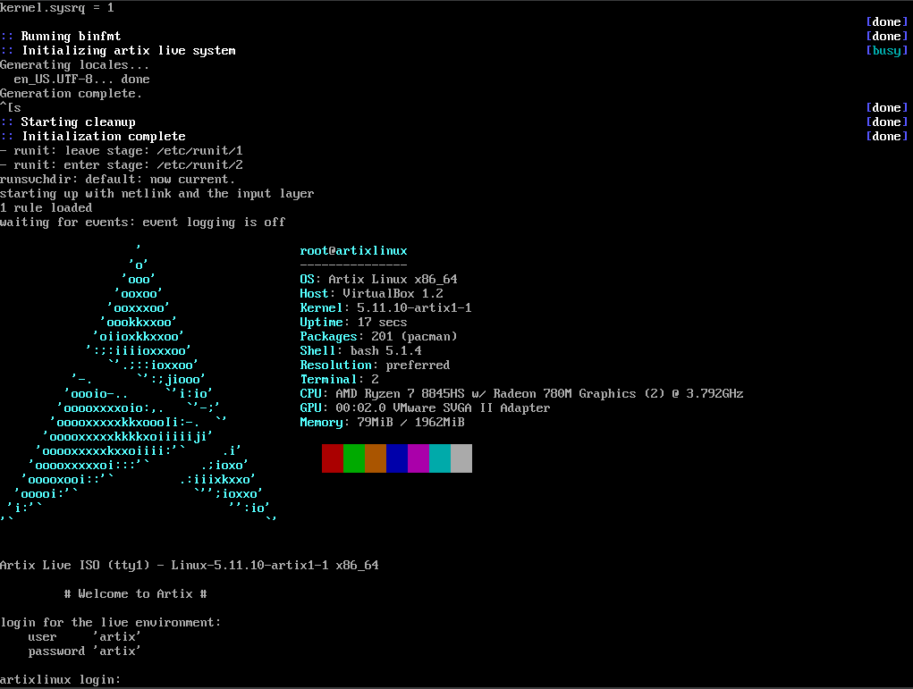

# 🤔 How to Install Artix Base Runit?
- [🤔 How to Install Artix Base Runit?](#-how-to-install-artix-base-runit)
  - [Introduction](#introduction)
  - [Download ISO](#download-iso)
    - [Lowmem Version](#lowmem-version)
  - [Initial Screen (before login)](#initial-screen-before-login)
    - [Lowmem Version](#lowmem-version-1)
  - [Login](#login)
    - [Lowmem Version](#lowmem-version-2)
  - [Storage Device Partitioning](#storage-device-partitioning)
    - [How do we know if our storage device is /dev/sda?](#how-do-we-know-if-our-storage-device-is-devsda)
    - [Which partitions to create and why?](#which-partitions-to-create-and-why)
    - [Format Partitions](#format-partitions)
    - [Mount partitions](#mount-partitions)
  - [Install base system + linux-zen + runit](#install-base-system--linux-zen--runit)
  - [Fstab](#fstab)
  - [Chroot](#chroot)
  - [Basic configuration](#basic-configuration)
    - [Time zone](#time-zone)
    - [Locales](#locales)
    - [Hostname](#hostname)
    - [Create root password](#create-root-password)
  - [Generate initramfs](#generate-initramfs)
  - [Install rEFInd](#install-refind)
  - [Config network (runit)](#config-network-runit)
  - [Create user and add to sudoers](#create-user-and-add-to-sudoers)
  - [Exit, umount and reboot](#exit-umount-and-reboot)
  - [Install Terminal Emulator (Alacritty), Tiling Window Manager (DWM) and Display/Login Manager (LightDM)](#install-terminal-emulator-alacritty-tiling-window-manager-dwm-and-displaylogin-manager-lightdm)
  - [Config keyboard layout](#config-keyboard-layout)


## Introduction
Do you want to install Artix Base Runit and don't know where to start? Then you're in the right place. As you may have read in the [README](../../README.md) of the repository, whenever whe have an operating system installation guide, we also have a tutorial on [YouTube](https://youtu.be/tuzQFgk44C8). If you watch it, you'll see that the installation of the aforementioned distro was carried out on a virtual machine (using [Oracle VirtualBox](https://www.virtualbox.org/)). That doesn't mean you can't install it on a PC or laptop. The only difference is that you'll first need to create a bootable USB, which you can do using tools such as:
* [Rufus](https://rufus.ie/)
* [balenaEtcher](https://etcher.balena.io/)

## Download ISO
To download the ISO, go to the [official Artix download page](https://artixlinux.org/download.php). Them scroll down until you find the **Official ISO images** section, and within **Stable ISO images**, select **base** (_artix-base-runit[...]-x86_64.iso_).

> [!WARNING]
> This dropdown and its content apply only to the ISO version **artix-base-runit-20250825**. The error described occurred around 08/26/2025.

<details>
  <summary>Problems with the 2025 ISO version</summary>

  Once I had downloaded the ISO and started installing the distro, I ran into a problem: "Incorrect login". In this distro, you must log in with a user and password provided by Artix to continue the installation, but in the 2025 ISO version, any user/password combination fails.
  ```bash
  user = 'root' or 'artix'
  password = 'artix'
  ```

  I searched for information about the error and possible solutions, but apparently there's nothing to be donde until it's fixed. I don't know if I'm the only one who encountered this issue; if I'm mistaken and there is a solution, I sincerely apologize and encourage you to let me know (it's never too late to learn).

  So what do we do? Do we just not install the distro?

  No. The simplest solution is to use and older version of Artix Base Runit. In this case, I performed the installation using the 2024 version, where this issue does not occur.

  The 2024 ISO can be found on [the same download page](https://artixlinux.org/download.php), under **Old and archived ISO images**, specifically **Old ISO images (click to expand)** inside **base**.
</details>

### Lowmem Version
There is a section on the [Artix website with **Testing ISO downloads**](https://iso.artixlinux.org/testing-isos.php). Here you can find a version of the distro based on Arch low-memory. This **Testing ISO downloads** section can also be found near the bottom of the [official Artix website](https://artixlinux.org/download.php).

> [!WARNING]
> This low-memory version, being from 2021, has issues installing various required packages, reaching a point where **sudo** and **pacman** break. Therefore, I recommend using the stable ISO.

> [!NOTE]
> You can still follow the guide. Changes related to the low-memory ISO are noted, but eventually it becomes impossible to continue with the low-memory version and the guid resumes using the stable ISO.

## Initial Screen (before login)


Here you need to adjust the ***time zone (tz)***, ***keyboard layout (keytable)*** and ***system language (lang)*** if they're not to your liking. For example, I kept the system language in English, but changed the time zone and keyboard layout.

### Lowmem Version


In the low-memory version, the initial screen looks slightly different, but functionally it's the same.

> [!NOTE]
> In this initial menu, navigation is done using the keyboard.

To exit and continue the installation, select ***From Stick/HDD: artix.x86_64***.

## Login


In Artix, there is an initial login that mush be completed correctly before starting the installation commands.
```bash
user = 'root'
password = 'artix'
```

### Lowmem Version


In the low-memory version, we cannot log in as superuser. Use the following credentials:
```bash
user = 'artix'
password = 'artix'
```

> [!IMPORTANT]
> Since we are not logged in as root, we must either use **sudo** for every command or elevate privileges with **sudo su**.

## Storage Device Partitioning
For partitioning the storage device, we will use a text-based tool called **cfdisk**. To start creating partitions, run:
```bash
cfdisk /dev/sda
```

In the low-memory version:
```bash
sudo cfdisk /dev/sda
```

### How do we know if our storage device is /dev/sda?
Linux usually names storage devices in detection order. If the drive is connected via SATA/IDE/SCSI, it will typically be **/dev/sda**.

If it's an NVMe drive, it may be **/dev/nvme0n1**. You can verify with:
```bash
lsblk
```
```bash
fdisk -l
```

### Which partitions to create and why?
| **Partición** | **Tamaño**      | **Función**                                                               |
| ------------- | --------------- | ------------------------------------------------------------------------- |
| EFI           | 512 MB          | UEFI boot partition containing bootloaders.                               |
| Swap          | 8 GB            | Memory swap area, used for hibernation or low RAM situations.             |
| / (root)      | 30 GB           | Root partition containing the OS and applications.                        |
| /home         | remaining space | Stores personal user files, allowing OS reinstallation without data loss. |

### Format Partitions
| Partición | Formato | Motivo                            |
| --------- | ------- | --------------------------------- |
| EFI       | FAT32   | Required by the UEFI standard.    |
| Swap      |         | Initialized, not formatted.       |
| / (root)  | ext4    | Standard robust Linux filesystem. |
| /home     | ext4    | Same as root.                     |

Once we know the formats we need to use for each partition, we can run the following commands:
* **EFI - FAT32**
  ```bash
  mkfs.fat -F32 /dev/sda1
  ```
* **Swap**
  ```bash
  mkswap /dev/sda2
  ```
* **/ (root) - EXT4**
  ```bash
  mkfs.ext4 /dev/sda3
  ```
* **/home - EXT4**
  ```bash
  mkfs.ext4 /dev/sda4
  ```

In the case of the low-memory version, we need to do the following:
* **/ (root) - EXT4**
  ```bash
  sudo mkfs.ext4 /dev/sda3
  ```
* **/home - EXT4**
  ```bash
  sudo mkfs.ext4 /dev/sda4
  ```
* **Swap**
  ```bash
  sudo mkswap /dev/sda2
  ```

We have not formatted the EFI partition because this version of Artix Base Runit does not come with many tools preinstalled, among then **dosfstools**. This tool provides the **mkfs.fat -F32** command used to format the **EFI** partition as FAT32.
```bash
sudo pacman -S dosfstools
```

When we try to install this package, we get hte following warning messages:
```bash
warning: database file for 'system' does not exist (use '-Sy' to download)
warning: database file for 'world' does not exist (use '-Sy' to download)
warning: database file for 'galaxy' does not exist (use '-Sy' to download)
warning: database file for 'extra' does not exist (use '-Sy' to download)
warning: database file for 'community' does not exist (use '-Sy' to download)
error: target not found: dosfstools
```

This happens because the databases that **pacman** is trying to use do not exist in this version of Artix. Therefore, we need to edit the configuration file of the package manager so that these repositories are no longer recognized.
```bash
sudo nano /etc/pacman.conf
```

What er need to tod is comment out the following lines:
```bash
[extra]
Include = /etc/pacman.d/mirrorlist-arch

[community]
Include = /etc/pacman.d/mirrorlist-arch
```

Once we save and exit the editor, we need to run the following command to synchronize the package databases:
```bash
sudo pacman -Syy
```

Now we can install the **dosfstools** package:
```bash
sudo pacman -S dosfstools
```

Once we have this package installed, we can format the **EFI** partition. However, errors still appear when trying to format it:
```bash
version `GLIBC_2.38' not found
version `GLIBC_2.34' not found
version `GLIBC_ABI_DT_RELR' not found
```

This is due to how old this specific low-memory distro is. If we try:
```bash
sudo pacman -Syyu
```

We get errors because dependencies such as **hwids** and **eudev** have been removed from package repositories over time. Therefore, teh only solution is to try to manually migrate outdated components, since the other option would be to switch to a newer ISO (which dows not exist for the low-memory version). To do this, we run:
```bash
sudo pacman -Rdd eudev
```
```bash
sudo pacman -Scc
```
```bash
sudo pacman -Sy pacman archlinux-keyring artix-keyring
```

After doing this, we realize that **sudo** and **pacman** have stopped working. This happens because our **glibc** version is 2.33. When running the last command, packages were downloaded thar require **glibc** 2.34, 2.38, etc, which rely on functions that our version dows not have. As a result, when we try to use **sudo** or **pacman**, we get errors like:
```bash
libcrypto.so.1.1: cannot open shared object file
```
When we see an error like this, it means that **sudo** or **pacman** cannot be loaded because they depend on libraries that do not exit on our system.

At this point, since it is becoming very difficult to continue with the low-memory version, we will not proceed with it and will continue the installation using the stable ISO (we leave solving this issue for future releases).

In any case, if you know how to fix this or how to fully install the low-memory version, I encourage you to contact me or leave a comment on the Artix Base Runit video on my YouTube channel so we can understand what we are doing wrong, what we are missing and so on.

### Mount partitions
Once the partitions are created and formatted, we need to mount them. Mounting each partition is necessary for the system to use them, since Linux organizes everything into a single directory tree starting at **/** and, by default, partitions are not assigned to any specific point in the tree, we must do that ourselves.

1. To mount the root partition:
   ```bash
   mount /dev/sda3 /mnt
   ```
   Here, ***/mnt*** acts as the temporary root of the new system.

2. To mount EFI at ***/boot***:
    ```bash
   mkdir /mnt/boot
   ```
   ```bash
   mount /dev/sda1 /mnt/boot
   ```
   This ensures that the bootloader will be installed there.

3. To mount ***/home***:
   ```bash
   mkdir /mnt/home
   ```
   ```bash
   mount /dev/sda4 /mnt/home
   ```
   This ensures that user data is stored on its own partition.

4. To enable ***/swap***:
   ```bash
   swapon /dev/sda2
   ```
   This makes the swap partition available when needed.

## Install base system + linux-zen + runit
Now we are going to install everything minimal and essential for our distro. To do this, we use **basestrap**, which copies the selected packages into the root partition we just mounted (/mnt).

Below is the full command, followed by an explanation of each package:
```bash
basestrap /mnt base base-devel linux-zen linux-zen-headers linux-firmware \
  runit elogind-runit dhcpcd-runit sudo
```
* **base**

  Minimal set of packages required to have a functional Arch (or Arch-based) system (shell, basic utilities, core system components...).

* **base-devel**

  Compilation tools (gcc, make...). Useful for installations that require building software from source.

* **linux-zen**

  A modified Linux kernel designed to improve responsiveness and latency for desktop environments, gaming and multimedia, prioritizing smooth user interaction.

* **linux-zen-headers**

  Kernel headers required to install drivers or external modules.

* **linux-firmware**

  Firmware for graphics cards, Wi-Fi, Bluetooth... Without this, some hardware will not work.

* **runit**

  An alternative init system to systemd. Lightweight, fast, and simple.

* **elogind-runit**

  Login/session manager implementation for runit (replacement for systemd's logind). Required for graphical sessions and proper user permissions.

* **dhcpcd-runit**

  DHCP client with runit integration, required to automatically obtain an IP addres and have network connectivity.

* **sudo**

  Allows running commands as root fron a normal user with permissions. Essential for system administration without logging in as a root.

## Fstab
At this point, we need to run the following command, which defines how partitions will be mounted automatically every time the system boots:
```bash
fstabgen -U /mnt >> /mnt/etc/fstab
```
> [!NOTE]
> **fstab** is a Linux configuration file that specifies which partitions to use, where to mount them, which filesystem to use, and more.

## Chroot
Chroot means "change root". It makes a directory act as as the root of the new system we are installing, without needing to reboot.

In Artix, the command is **artix-chroot**, a version of the traditional chroot adapted for this distro. Behind the scenes, it dows the following:
1. Enters the new system (/mnt).
2. Mounts and trasnfers necessary components from the current environment (such as /proc, /sys, /dev...) so the new system behaves as if it were already running.

In short, the temporary root (/mnt) becomes the real root of the system.

```bash
artix-chroot /mnt
```

## Basic configuration
### Time zone
```bash
ln -sf /usr/share/zoneinfo/Europe/Madrid /etc/localtime
```
This command links your time zone (in this case, Europe/Madrid) to ***/etc/localtime***, which Linux uses to determine the correct time.

```bash
hwclock --systohc
```
This synchronizes the hardware clock (BIOS/UEFI) with the system time.

### Locales
```bash
echo "es_ES.UTF-8 UTF-8" >> /etc/locale.gen
```
This tells the system which language to support. In this case, Spanish is selected, but it could be any other (UK English "en_GB.UTF-8 UTF-8" or US English "en_US.UTF-8 UTF-8").

```bash
locale-gen
```
This generates the required language files.

```bash
echo LANG=es_ES.UTF-8 > /etc/locale.conf
```
This defines the system's primary language.

### Hostname
```bash
echo artixvbox > /etc/hostname
```
This defines the computer's name on the network.

```bash
cat >> /etc/hosts <<EOF
127.0.0.1 localhost
::1       localhost
127.0.1.1 artixvbox.localdomain artixvbox
EOF
```
This links the hostname to the local IP so that internal networking and services work correctly.

### Create root password
```bash
passwd
```
This command sets a password for a specific user. Since no username is specified, it sets the password for root.

## Generate initramfs
When installing a kernel on an Arch-based distro like Artix Base Runit, the system not only installs the kernel binary, but also needs an **initramfs** (initial RAM filesystem). This is a compressed file containing essential kernel modules, boot hooks and configuration required to mount ht **root filesystem** (/).

Therefore, we run:
```bash
mkinitcpio -P
```
This generates **initramfs** for all installed kernels.

## Install rEFInd
```bash
pacman -S refind efibootmgr
```
This installs the rEFInd boot manager and the tool used to manage UEFI entries.

```bash
refind-install
```
This copies rEFInd files to the EFI partition and registers it with the firmware so the system can boot.

Next, we need to find the UUID of our root (/) partition and add it to **/boot/refind_linux.conf**, both on the first and second lines:
```bash
blkid
```
Once we have the UUID, we edit the file:
```bash
nano /boot/refind_linux.conf
```
And add the UUID to both lines:
```bash
"Boot with standard options" "lang=en_US keytable=es tz=Europe/Madrid label=ARTIX_202408 root=UUID=[...]"
"Boot to single-user mode" "lang=en_US keytable=es tz=Europe/Madrid label=ARTIX_202408 root=UUID=[...] single"
```

## Config network (runit)
```bash
sudo ln -s /etc/runit/sv/dhcpcd /etc/runit/runsvdir/default/
```
This enables the dhcpcd network service in runit so the system automatically obtains an IP address at boot.

## Create user and add to sudoers
```bash
useradd -m -G wheel -s /bin/bash username
```
```bash
passwd username
```
These commands create a normal user, add them to the wheel (admin) group, assign bash as their shell, and set a password.

```bash
pacman -S nano
```
If nano is already installed, this step can be skipped.
```bash
nano /etc/sudoers
```
Uncomment the following line:
```bash
%wheel ALL=(ALL) ALL
```
This allows any user in the wheel group to use sudo.

## Exit, umount and reboot
```bash
exit
```
This exits the chroot and returns to the ISO environment.

```bash
umount -R /mnt
```
This unmounts all partitions.

```bash
reboot
```
Finally, reboot the system.

## Install Terminal Emulator (Alacritty), Tiling Window Manager (DWM) and Display/Login Manager (LightDM)
Currently, the system boots into a TTY (terminal interface), and we want a graphical login, a tiling window manager, and our favourite terminal emulator. First, we must install a graphical server. In this case, we use **Xorg**, since **DWM** is only compatible with **Xorg** and not **Wayland**.
```bash
sudo pacman -Syu # to update the operating system before installing everything that follows
```

```bash
sudo pacman -S xorg-server xorg-xinit xorg-xrandr xorg-xsetroot xterm alacritty
```

To test the graphical server:
```bash
startx
```
Exit once verified:
```bash
exit
```

Install **DWM** dependencies:
```bash
sudo pacman -S git libxft libxinerama
```

Create the **.config** directory:
```bash
mkdir ~/.config
```

```bash
git clone git://git.suckless.org/dwm ~/.config/dwm
```
```bash
git clone git://git.suckless.org/st ~/.config/st
```
```bash
git clone git://git.suckless.org/dmenu ~/.config/dmenu
```

```bash
cd ~/.config/dwm && sudo make install
```
```bash
cd ~/.config/st && sudo make install
```
```bash
cd ~/.config/dmenu && sudo make install
```

Install **lightdm**:
```bash
sudo pacman -S lightdm lightdm-gtk-greeter lightdm-gtk-greeter-settings
```

Enable the service:
```bash
sudo ln -s /etc/runit/sv/lightdm /etc/runit/runsvdir/default/
```

Add **DWM** to session menu:
```bash
sudo mkdir /usr/share/xsessions
```
```bash
sudo nano /usr/share/xsessions/dwm.desktop
```

Add:
```bash
[Desktop Entry]
Encoding=UTF-8
Name=Dwm
Comment=the dynamic window manager
Exec=dwm
Icon=dwm
Type=XSession
```

Change **DWM** default terminal:
```bash
sudo nano ~/.config/dwm/config.h
```

Replace:
```bash
static const char *termcmd[]  = { "st", NULL };
```

With:
```bash
static const char *termcmd[]  = { "alacritty", NULL };
```

Recompile:
```bash
cd ~/.config/dwm
```
```bash
sudo make clean install
```

Create **LightDM** run script:
```bash
sudo mkdir -p /etc/runit/sv/lightdm
```
```bash
sudo nano /etc/runit/sv/lightdm/run
```

Add:
```bash
exec 2>&1

export PATH=/usr/local/sbin:/usr/local/bin:/usr/sbin:/usr/bin:/sbin:/bin
export LANG=en_US.UTF-8
export HOME=/root
export XDG_RUNTIME_DIR=/run/lightdm

install -d -m 0700 -o root -g root /run/lightdm

exec /usr/sbin/lightdm
```

Make executable:
```bash
sudo chmod +x /etc/runit/sv/lightdm/run
```

Enable and start:
```bash
sudo ln -s /etc/runit/sv/lightdm /etc/runit/runsvdir/default/
```
```bash
sudo sv start lightdm
```

> [!WARNING]
> I have not managed to make LightDM start automatically with the system. With the run script above, it only worked once and after rebooting it no longer starts. This is my first time using runit and I haven't found clear documentation on this issue with Artix Base Runit and LightDM. If you know how to fix it, feel free to open a PR or contact me via YouTube, TikTok, Likeding...

## Config keyboard layout
Finally, we configure the keyboard layout to avoid having to run **sudo loadkeys es** every time the system starts. Edit the following file:
```bash
sudo nano /etc/vconsole.conf
``` 
Add:
```bash
KEYMAP=es
```